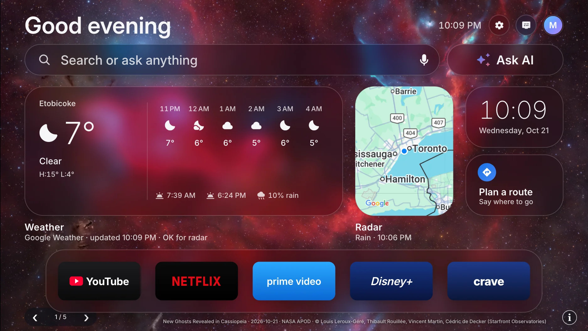

<div align="center">


# Android TV Launcher

**An ad-free home screen for Android TV, with Ask AI, live radar, routes and NASA's picture of the day.**

Built for a Sony BRAVIA on Android TV 10. Based on [Free My TV](https://github.com/simbasjungles/free-my-tv).<br>
Open source. Built with Claude Code. One button to undo.

[What you get](#what-you-get) · [Install](#install) · [Set up the keys](#set-up-ask-ai-the-weather-and-the-maps) · [Going back](#going-back) · [What changed](SONY.md)



</div>

## What you get

- **A calm home screen.** A greeting and the clock, a big search row, and four glass boxes: the weather, a radar map,
  the time, and *Plan a route*. Your apps sit on a glass shelf below.
- **NASA's picture of the day as the background.** A new space photo every day, no key needed. Press ↓ under the
  shelf to browse the last five (**‹ 1 / 5 ›**) or open one in full with NASA's description (**ⓘ**).
- **Ask AI.** Ask anything, said or typed, and Gemini answers in large type, with its sources. Follow-ups keep the
  conversation; *New chat* starts over.
- **Voice that works on this TV.** Hold the remote's mic button to talk, or press a mic on screen and just speak.
  If the remote isn't paired, the screen tells you where to pair it.
- **Weather and radar.** The forecast hour by hour, sunrise, sunset and the chance of rain. OK on the weather or
  radar card shows the last hour of radar, animated, on a map (Environment Canada in Canada, NOAA in the US).
- **Plan a route.** Say or type a place, pick from the matches near home, and see the drive with live traffic.
- **Frosted glass, even on older TVs.** Android 9 to 12 can't blur live, so the photo's blur is made once and each
  glass box shows its piece of it.
- **Your keys stay safe.** Send them from your computer once; the TV stores them encrypted and never logs them.
- **No ads, nothing uninstalled.** Promo apps are turned off, never removed, and one button brings back the factory
  home screen.

Every Google feature is optional. Without any keys, the weather comes from Open-Meteo, the maps from Esri, and NASA's
photo needs no key at all.

## Install

About ten minutes. You need an Android TV or Google TV (Android 9 or newer) and a computer on the same Wi-Fi.

### The easy way: Claude Code

1. **On the TV**, turn on developer mode: Settings → Device Preferences → About → press *Build* 7 times. Then
   Settings → Device Preferences → Developer options → turn on **USB debugging**. Write down the TV's IP address
   (Settings → Network & Internet).
2. **On your computer**, get the code:
   ```bash
   git clone https://github.com/mehere14/android-tv-launcher && cd android-tv-launcher
   ```
3. **Open [Claude Code](https://claude.com/claude-code) in that folder** and say:
   > Install it on my TV at 192.168.1.50. I live in Toronto.

   It installs the tools it needs, builds the app and puts it on your TV. Swap in your TV's IP and your city.
4. **On the TV**, open *Free My TV* → *Home Screen* → *Free My TV*, and accept the debugging prompt (tick *Always
   allow*). The app is still called Free My TV on the TV.

### The manual way

1. **On the TV**, do step 1 above.
2. **Tools:** a JDK (17+), the Android SDK command-line tools (build-tools 34, platform android-34) and adb. On a Mac:
   ```bash
   brew install --cask temurin android-commandlinetools android-platform-tools
   sdkmanager "build-tools;34.0.0" "platforms;android-34"
   ```
   On Linux, get OpenJDK 17, Android's command-line tools and adb from your package manager, then run the same
   `sdkmanager` line. On Windows, use WSL.
3. **Build:**
   ```bash
   ./build.sh
   ```
   The first run creates `config.properties`. Set your city there (see [the keys](#set-up-ask-ai-the-weather-and-the-maps)),
   then run it again.
4. **Install:**
   ```bash
   adb connect 192.168.1.50:5555
   adb install -r FreeMyTV.apk
   ```
5. **On the TV**, open *Free My TV* → *Home Screen* → *Free My TV*, and accept the debugging prompt.

## Set up Ask AI, the weather and the maps

Every key is optional and free to start.

| Key | What it turns on | Where to get it |
|---|---|---|
| `gemini_key` | Ask AI (answers, follow-ups, sources) | [Google AI Studio](https://aistudio.google.com/apikey) → *Create API key* |
| `maps_key` | Google Weather, Google's map, the radar map, Plan a route | [Google Cloud console](https://console.cloud.google.com/google/maps-apis) (below) |
| `tmdb_key` | Photos for the optional screensaver (`own_screensaver=true`) | [themoviedb.org](https://www.themoviedb.org/settings/api) → Settings → API |

**The Google Maps Platform key, step by step**

1. In the [Google Cloud console](https://console.cloud.google.com/), create a project (or pick one) and add a billing
   account. Google asks for one even within the free monthly allowance.
2. Turn on these APIs (*APIs & Services* → *Library*): **Map Tiles API**, **Weather API**, **Places API (New)**,
   **Routes API** and **Geocoding API**.
3. *APIs & Services* → *Credentials* → *Create credentials* → *API key*. Under *API restrictions*, allow only the five
   APIs above.
4. *Billing* → *Budgets & alerts*: set a small budget so you hear about any surprise.

**1. Make `config.properties`.** In the project folder, run `./build.sh` once: it copies `config.example.properties`
to `config.properties` (or copy it yourself). Git ignores this file, so your keys never reach GitHub.

**2. Fill it in.** Paste each key after its `=`, with no quotes or spaces:

```properties
# Your place: the weather, the sunset (night look) and "near home" for routes
latitude=43.65
longitude=-79.38
city=Toronto
tmdb_region=CA
temperature=C

# Ask AI
gemini_key=PASTE_YOUR_GEMINI_KEY
gemini_model=gemini-flash-latest
gemini_grounding=true

# Weather, maps, radar map, routes
maps_provider=google
maps_key=PASTE_YOUR_MAPS_KEY
```

Use your own city's latitude and longitude, in decimal degrees: right-click your area in Google Maps and click the
numbers to copy them.

**3. Build and install** (your place is built into the app):

```bash
./build.sh
adb connect <TV-IP>:5555
adb install -r FreeMyTV.apk
```

**4. Send the Gemini and Maps keys to the TV.** They're not built into the app. The TV reads them from a pushed copy of
the file, which only the TV's debugging shell can open:

```bash
adb push config.properties /data/local/tmp/freemytv.properties
adb shell chmod 600 /data/local/tmp/freemytv.properties
```

Then press **Home** on the remote. The app imports `gemini_key`, `gemini_model`, `gemini_grounding` and `maps_key`,
stores them encrypted on the TV (Android Keystore), deletes the pushed file, and shows *"Keys received from your
computer and stored securely."* Nothing else in the file is read.

This works once the TV is switched to Free My TV (*Free My TV* → *Home Screen* → *Free My TV*) and you've accepted its
*Allow USB debugging?* prompt for the app: the import uses the TV's own debugging connection. No message after
pressing Home? Check `adb logcat -s FreeMyTV` for a `keys:` line.

**5. Check it.** On the TV, open *Free My TV* → *Ask AI* → **Test connection**. The key shows only its last 4
characters. The weather card's footer says which service it used (Google or Open-Meteo).

**Changing a key later:** edit `config.properties` and repeat step 4. You only need to build again for changes to the
place or the TMDB key.

**Trying it on the computer first:** `python3 mockup/server.py`, then open http://localhost:8765/. The mockup reads the
same `config.properties`. With a `maps_key`, a `postal_code=` line there also fills in your latitude, longitude and
city.

## Settings

The first values come from `config.properties`. Some can also be changed on the TV, in *Free My TV* → *Home
Settings*, and the TV's choice wins:

| Key | What it does | Default |
|---|---|---|
| `latitude`, `longitude` | Your city, for the weather, the sunset and routes | New York |
| `city` | The name on the weather card | `Weather` |
| `language` | `auto` (follows the TV), `en`, `es` or `pt` | `auto` |
| `temperature` | `C`, `F` or `auto` | `auto` |
| `gemini_key`, `gemini_model`, `gemini_grounding` | Ask AI (sent to the TV, see above) | empty, `gemini-flash-latest`, `true` |
| `maps_key` | Google Maps Platform: weather, maps, radar map, routes (sent to the TV) | empty |
| `profile_initial` | The letter on the home screen's Profile button | empty |
| `own_screensaver` | Make it the screensaver too (otherwise the TV keeps its own, like Ambient mode) | `false` |
| `tmdb_key`, `tmdb_region` | Photos for that screensaver | empty, `US` |
| `disable_assistant` | Also turn off Google Assistant | `false` |

Changed something? Run `./build.sh` and install again. Keep `freemytv.keystore`: updates must be signed with it.

## Going back

On the TV: *Free My TV* → *Home Screen* → *Original*. The factory home screen and every app it turned off come back
exactly as they were (apps that were already off before stay off). If the new home screen ever crashes three times in
five minutes, it switches back by itself.

To remove it for good, switch to *Original* first, then uninstall *Free My TV* (Settings → Apps).

### Rebuild, reinstall, undo (from your computer)

```bash
./build.sh                                   # after changing config.properties or the code
adb connect 192.168.1.50:5555                # your TV's IP; "Always allow" on the TV the first time
adb install -r FreeMyTV.apk                  # an update keeps your settings and the switch
```

Keep `freemytv.keystore`: an update signed with another key won't install (you'd have to switch to *Original* and
uninstall first).

**Undo without the app** (it crashed, or was uninstalled while switched): turn the apps back on, then give the home
screen back. On a Sony, the TV's original values, recorded before the first switch, are in `sony-before.txt`.

```bash
for p in com.google.android.tvlauncher com.google.android.tvrecommendations com.google.android.play.games \
  com.sony.dtv.promos com.sony.dtv.sonyselect com.sony.dtv.demosupport com.sony.dtv.demosystemsupport \
  com.sony.dtv.multiscreendemo com.sonyericsson.idd.agent com.sony.dtv.tvlaunchercustomizer \
  com.sony.dtv.tvlaunchercustomizer.overlay.apporder; do adb shell pm enable $p; done
adb shell cmd package set-home-activity com.google.android.tvlauncher/.MainActivity
```

The screensaver needs nothing: with `own_screensaver=false` the app never changes it.

## What it changes on the TV

- It becomes the home screen (and the screensaver too, only with `own_screensaver=true`).
- It turns off, without uninstalling:
  - the stock home screen (and its screensaver, only with `own_screensaver=true`);
  - Google TV's recovery home, Play Games and YouTube Music;
  - on Sony TVs, Sony's promotions, Sony Select, the store demo, usage reporting and the stock home screen's customizer;
  - on TCL TVs, the TCL Channel, messages, store demo, hotel menu, manuals, mirroring and logging apps;
  - Google Assistant, only with `disable_assistant=true`.
- Picture, sound, inputs, remote pairing, Google services and the Play Store are on a protected list, checked before
  every change.
- Apps that saved a Wi-Fi network are never turned off, since Android would erase the network. If the TV's first
  setup saved yours, the switch asks you to forget the network and connect again in Settings first.

**Another brand of Android TV?** Open the folder in Claude Code and say *"set it up for my TV"*: it reads your TV,
finds its home screen and its promo apps, and updates `DEBLOAT` and `PROTECTED` in
[`HomeMode.java`](app/src/io/freemytv/HomeMode.java). [CLAUDE.md](CLAUDE.md) tells it how.

**LG, Samsung or another kind of TV?** This project focuses on Android TV. The original
[Free My TV](https://github.com/simbasjungles/free-my-tv) has the LG (webOS) and Samsung (Tizen) versions, without the
features above.

## How it works

- **A plain Android app, no Gradle, no libraries.** [`build.sh`](build.sh) runs aapt2 → javac → d8 → zipalign →
  apksigner and makes a 2 MB APK.
- **It uses the TV's own ADB, from inside the TV.** The app connects to `127.0.0.1:5555` with its own key (that's the
  *Allow USB debugging?* prompt) and runs the same commands you would. Nothing listens to the network.
- **Drawn by hand on one Canvas**, with Android 13 shaders for the glass, and a pre-blurred photo on Android 9 to 12.
  On the Sony, 99% of frames take 8 to 9 ms while the focus moves.
- **A safety net.** A watchdog brings back the stock home screen after three crashes in five minutes.

| File | What it is |
|---|---|
| [`HomeView.java`](app/src/io/freemytv/HomeView.java) | The home screen |
| [`Apod.java`](app/src/io/freemytv/Apod.java), [`ApodActivity.java`](app/src/io/freemytv/ApodActivity.java) | NASA's picture of the day, and the full view |
| [`AskActivity.java`](app/src/io/freemytv/AskActivity.java), [`Gemini.java`](app/src/io/freemytv/Gemini.java) | Ask AI |
| [`Voice.java`](app/src/io/freemytv/Voice.java) | Voice, from the remote's mic |
| [`HomeData.java`](app/src/io/freemytv/HomeData.java) | Weather (Google or Open-Meteo) |
| [`Radar.java`](app/src/io/freemytv/Radar.java), [`RadarActivity.java`](app/src/io/freemytv/RadarActivity.java) | The radar |
| [`PlanActivity.java`](app/src/io/freemytv/PlanActivity.java), [`Places.java`](app/src/io/freemytv/Places.java) | Plan a route |
| [`MapTiles.java`](app/src/io/freemytv/MapTiles.java) | The maps |
| [`Keys.java`](app/src/io/freemytv/Keys.java) | The keys, encrypted on the TV |
| [`Scene.java`](app/src/io/freemytv/Scene.java), [`Backdrop.java`](app/src/io/freemytv/Backdrop.java) | The glass and the background |
| [`HomeMode.java`](app/src/io/freemytv/HomeMode.java) | Switching between Free My TV and Original |
| [`SettingsActivity.java`](app/src/io/freemytv/SettingsActivity.java) | The settings screen (the app's icon) |
| [`mockup/`](mockup) | The design reference, in a browser with live data |

[SONY.md](SONY.md) lists everything this project changes from the original, in the order it was built.

## Privacy

No accounts, no analytics, no tracking. The app talks to the services you turn on: Google (Gemini, Weather, Maps,
Places, Routes) with your own keys, and without keys Open-Meteo and Esri. NASA's photo comes from NASA, and the
radar from Environment Canada or NOAA. Your settings and keys stay on your computer and your TV.

## Credits

- Based on [Free My TV](https://github.com/simbasjungles/free-my-tv) by its contributors (MIT).
- Built with [Claude Code](https://claude.com/claude-code).
- Background photos: NASA's [Astronomy Picture of the Day](https://apod.nasa.gov/); each photo's credit is shown with it.
- Weather data by [Open-Meteo.com](https://open-meteo.com/) (CC BY 4.0). Radar from Environment Canada and NOAA.
- This product uses the TMDB API but is not endorsed or certified by [TMDB](https://www.themoviedb.org/).
- Icons: [Material Symbols](https://fonts.google.com/icons) (Apache 2.0). Font: [Inter](https://rsms.me/inter/) (SIL OFL 1.1).
- Not affiliated with Google, Sony, NASA or any streaming service. App names and logos belong to their owners.

## License

[MIT](LICENSE).
